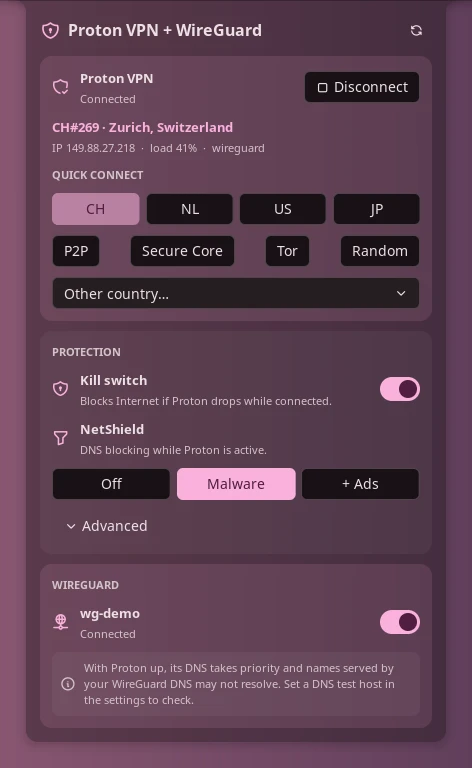

# Proton VPN + WireGuard

[English](README.md)

Gestiona Proton VPN y tus túneles WireGuard de NetworkManager desde la barra,
un panel y el centro de control: conectar, cambiar de país, activar el kill
switch y NetShield, y levantar o bajar túneles WireGuard.

> **Solo gestión.** El plugin enciende, apaga y muestra el estado. La
> configuración se hace por CLI: los túneles y peers de WireGuard con `nmcli`
> (o `nm-connection-editor`), y Proton VPN con el CLI oficial `protonvpn`.



## Plugin

| Campo | Valor |
| --- | --- |
| ID | `gitgxldf1sh/proton-wireguard` |
| Entradas | Widget de barra: `bar`; panel: `panel`; servicio: `service`; atajo: `proton` |

## Requisitos

Puedes usar solo una de las dos partes. El panel muestra únicamente lo que está
configurado y te indica qué parte falta.

- **Proton VPN:** `proton-vpn-cli` 1.0.5 o posterior, con `proton.VPN.service`
  en marcha y la sesión iniciada. Probado con el CLI 1.0.5.
- **WireGuard:** `nmcli` de NetworkManager. Solo se listan conexiones
  gestionadas por NetworkManager; los túneles levantados con `wg-quick` no.
- `getent` (glibc) para la comprobación de DNS opcional, `bash` para el
  asistente de inicio de sesión y `pkill` (procps) para cancelar un intento de
  conexión. Los tres vienen en prácticamente cualquier sistema.
- Los botones P2P, Secure Core, Tor y aleatorio y los ajustes avanzados usan
  opciones del CLI 1.1.0. Los ajustes que un CLI más antiguo no informa se
  ocultan.

La configuración se hace fuera del plugin:

```sh
# Proton VPN (ejemplo en Arch y derivadas)
sudo pacman -S proton-vpn-cli
protonvpn signin <usuario>

# WireGuard: importar un .conf existente en NetworkManager
nmcli connection import type wireguard file wg0.conf
nmcli connection modify wg0 connection.autoconnect no   # opcional
```

## Uso

Añade el widget **Proton VPN + WireGuard** a una barra desde Ajustes → Barra.
Muestra un escudo (resaltado con Proton activo, con candado si el kill switch
está armado) y un icono de red cuando hay alguna WireGuard activa. El escudo
pasa a ser un escudo tachado en rojo cuando el kill switch está bloqueando
Internet tras una caída.

- **Clic izquierdo:** abre el panel.
- **Clic derecho:** conecta Proton, lo desconecta o cancela un intento de
  conexión en curso.

El panel también se abre con:

```sh
noctalia msg panel-toggle gitgxldf1sh/proton-wireguard:panel
```

Según lo que tengas configurado, el panel muestra:

- **Proton VPN:** conectar/desconectar (el botón cancela mientras conecta),
  servidor, ubicación, IP, carga y protocolo, botones de países favoritos,
  botones P2P / Secure Core / Tor / aleatorio y una lista con el resto de
  países.
- **Protección:** kill switch y NetShield (off, malware, malware + anuncios).
  **Avanzado** despliega redirección de puertos, VPN Accelerator, NAT moderada
  e IPv6.
- **WireGuard:** un interruptor por cada conexión WireGuard de
  NetworkManager, detectadas automáticamente.
- Un aviso de «falta por configurar» para la parte que falte, o una sola nota
  de «solo gestión» si no hay ninguna.

El atajo **`proton`** conecta Proton o lo desconecta. Se añade en
Ajustes → Centro de control → Atajos.

## Ajustes

| Ajuste | Tipo | Por defecto | Descripción |
| --- | --- | --- | --- |
| `favorite_countries` | `string_list` | `["CH", "NL", "US"]` | Códigos de país de dos letras para los botones de conexión rápida. |
| `quick_connect` | `select` | `fastest` | Qué hace conectar sin destino (botón del panel, clic derecho, atajo): servidor más rápido (`fastest`) o última conexión (`last`). |
| `hidden_connections` | `string_list` | `[]` | Nombres de conexiones de NetworkManager que no se muestran en el panel. |
| `dns_check_host` | `string` | `""` | Un nombre que solo resuelve el DNS de tu WireGuard (p. ej. `nas.lan`). Con Proton y una WireGuard activas a la vez, el DNS de Proton suele tener prioridad; el panel avisa si este nombre deja de resolverse. Vacío desactiva la comprobación. |
| `show_server` | `bool` | `false` | Muestra el servidor de Proton (p. ej. `CH#120`) junto al icono de la barra. |
| `notify` | `bool` | `true` | Avisar al conectar y si Proton o un túnel WireGuard se caen sin haberlo pedido desde el plugin. |

## IPC

```sh
noctalia msg plugin gitgxldf1sh/proton-wireguard:service all toggle-proton [destino]
noctalia msg plugin gitgxldf1sh/proton-wireguard:service all connect [destino]
noctalia msg plugin gitgxldf1sh/proton-wireguard:service all disconnect
noctalia msg plugin gitgxldf1sh/proton-wireguard:service all cancel
noctalia msg plugin gitgxldf1sh/proton-wireguard:service all killswitch <off|standard|toggle>
noctalia msg plugin gitgxldf1sh/proton-wireguard:service all netshield <off|malware-only|malware-ads-trackers|toggle>
noctalia msg plugin gitgxldf1sh/proton-wireguard:service all port-forwarding <on|off|toggle>
noctalia msg plugin gitgxldf1sh/proton-wireguard:service all toggle-wg <nombre|uuid>
noctalia msg plugin gitgxldf1sh/proton-wireguard:service all wg-up <nombre|uuid>
noctalia msg plugin gitgxldf1sh/proton-wireguard:service all wg-down <nombre|uuid>
noctalia msg plugin gitgxldf1sh/proton-wireguard:service all refresh
```

`destino` es opcional. Sin él, Proton conecta al servidor más rápido, o a la
última conexión si `quick_connect` vale `last`. Puede ser:

| Destino | Conecta a |
| --- | --- |
| `CH`, `"United States"` | El servidor más rápido de un país (código o nombre completo) |
| `CH#12` | Un servidor concreto |
| `city:Zurich` | El servidor más rápido de una ciudad |
| `p2p`, `securecore`, `tor`, `random` | El servidor P2P, Secure Core o Tor más rápido, o uno aleatorio |
| `NL+p2p` | Una combinación, unida con `+` |
| `last` | El último destino que conectó |
| `fastest` | El servidor más rápido, diga lo que diga `quick_connect` |

Un destino que el plugin no entiende se rechaza con una notificación en lugar
de conectar al servidor más rápido. `toggle-proton` cancela el intento mientras
Proton está conectando. `vpn-accelerator`, `moderate-nat` e `ipv6` aceptan
`on|off|toggle` igual que `port-forwarding`. `<nombre|uuid>` es el nombre o el
UUID de una conexión de NetworkManager.

## Notas

- **Qué no hace:** nunca crea, edita ni borra conexiones WireGuard, peers,
  claves, endpoints ni `AllowedIPs`, y no gestiona tu cuenta de Proton.
  **Iniciar sesión** abre `protonvpn signin` en un terminal, así que la
  contraseña y el 2FA van directamente al CLI oficial.
- **Procesos que lanza**, siempre con los argumentos pasados directamente
  (sin shell):
  - `protonvpn info | status | config list | countries list | connect | disconnect | config set <ajuste> <valor>`
  - `pkill -INT -f "protonvpn connect"`, solo al cancelar un intento de
    conexión
  - `nmcli -t -f NAME,UUID,TYPE,DEVICE,STATE connection show` y
    `nmcli connection up|down uuid <uuid>`
  - `getent hosts <dns_check_host>`, solo si ese ajuste está puesto
  - `bash signin.sh` en un terminal, solo al pulsar **Iniciar sesión**
- **Archivos:** lee `/sys/class/net/proton0` para detectar el túnel y
  `/sys/class/net/pvpnksintrf0|1` para detectar el kill switch. Escribe un
  único archivo, `last.json` en el directorio de datos del plugin, con el
  último destino. No hace peticiones de red por su cuenta.
- **Aviso de kill switch:** el estado «bloqueando Internet» se detecta por la
  interfaz del kill switch de Proton en NetworkManager. Si tu sistema usa el
  kill switch de Proton basado en nftables, el plugin no puede verlo y solo la
  notificación de caída menciona el kill switch.
- **Privilegios:** no usa `sudo`/`pkexec`. Levantar una conexión de
  NetworkManager usa las reglas de polkit normales de tu sesión.
- **Detección:** Proton cuenta como conectado solo mientras existe la interfaz
  `proton0`. Los perfiles propios de Proton en NetworkManager (`ProtonVPN …`)
  se excluyen de la lista de WireGuard, así que nunca se confunden.
- **Sondeo:** la interfaz del túnel cada segundo, la lista de WireGuard cada
  3 s, el estado de Proton cada 15 s mientras está conectado y sus ajustes cada
  60 s.
- El plugin lee la salida en inglés del CLI de Proton. Si una versión futura
  cambia el formato, el plugin podría necesitar una actualización.

## Licencia

[MIT](LICENSE)
